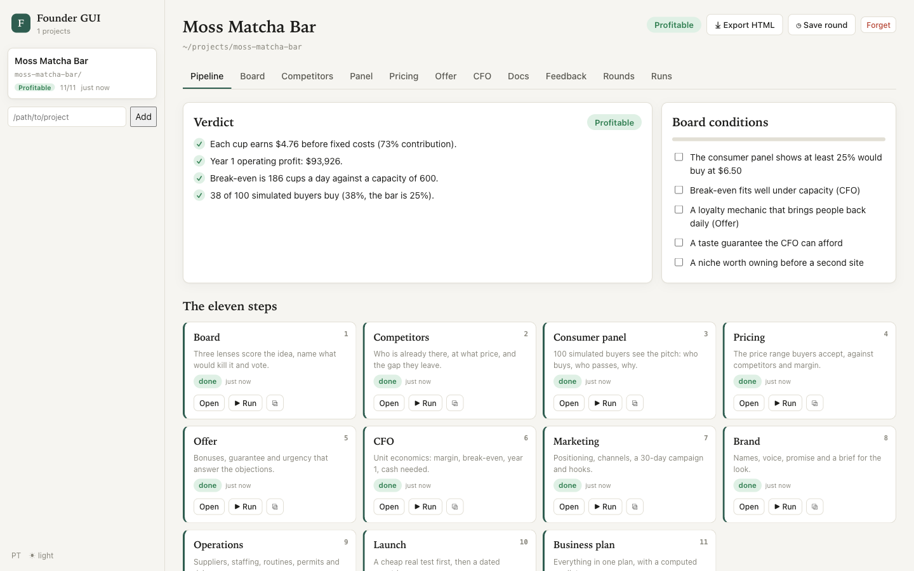
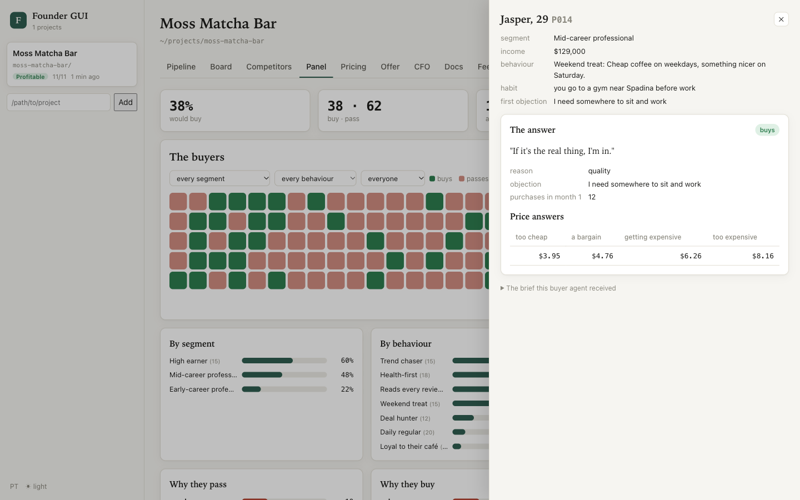

# The Founder skill

Eleven Claude skills that test a business before you launch it. Free, MIT, no
signup, no API key, nothing to connect.

`skills/founder-board` `skills/founder-marketing` `skills/founder-cfo`
`skills/founder-consumer` `skills/founder-launch` `skills/founder-pricing`
`skills/founder-offer` `skills/founder-competitors` `skills/founder-brand`
`skills/founder-ops` `skills/founder-plan`

One of them is your board of directors, trained on the frameworks of Alex
Hormozi, Peter Thiel and Steve Jobs. One is your marketing director. One is your
CFO and finds your real profit margins. And one is the consumer panel: it spins
up 100 buyer agents trained on your target customer and runs your business
through 100 buyer scenarios.

So you know how to launch, how to market and how to actually make money, before
you spend thousands of dollars finding out the hard way.

## Install

Paste this repo link into Claude and say `install skill`:

```
https://github.com/Jakeschincariol/founder-skill

install skill
```

Or as a plugin, in Claude Code:

```
/plugin marketplace add Jakeschincariol/founder-skill
/plugin install founder-skill@founder-skill
```

Claude Code namespaces plugin skills, so installed as a plugin they show up as
`/founder-skill:founder-board` and so on. Copy the folders instead if you want
plain `/founder-board`:

```bash
git clone https://github.com/Jakeschincariol/founder-skill.git
cp -r founder-skill/skills/founder-* ~/.claude/skills/
```

Project-local instead of global: copy the same folders into your repo's
`.claude/skills/`. No Claude Code at all? Paste any single `SKILL.md` at the top
of a chat and it runs as a mode. You lose the sub-agents and the Python tools,
but the method works.

The tools need Python 3.8 or newer. Nothing to pip install.

## The eleven

| command | job | what it does |
| --- | --- | --- |
| `/founder-board` | Board of Directors | Three board members, each a sub-agent applying one published framework (Offers, from *$100M Offers*; Monopoly, from *Zero to One*; Product, from Isaacson's *Steve Jobs*), score the idea, name what would kill it and vote. |
| `/founder-competitors` | Competitor Scout | Maps direct competitors, indirect ones and substitutes from public sources, with prices, positioning and what their customers complain about, every fact linked. |
| `/founder-consumer` | Consumer Panel | Spins up a swarm of buyer agents (100 by default) from your target customer, each with its own income, habits and objection, and tallies who buys, who doesn't and why. |
| `/founder-pricing` | Pricing Strategist | Turns the panel's price answers into an acceptable price range, sets it against competitors and your margin, and picks what to test. |
| `/founder-offer` | Offer Architect | Builds the offer stack (bonuses, guarantee, real urgency, a name) that answers the panel's objections, then re-tests it on the panel. |
| `/founder-cfo` | CFO | Unit economics: contribution per sale, the real profit margin, break-even per day, year 1 month by month, cash needed, payback, what-ifs. |
| `/founder-marketing` | Marketing Director | Positioning, the channels your buyers use, a dated 30-day launch campaign, ten hooks and the most you can pay for a customer. |
| `/founder-brand` | Brand Designer | Name candidates with the trademark, domain and handle checks to run, a voice, a promise and a brief for the look. |
| `/founder-ops` | Operations Manager | Suppliers, staffing, day-one routines, tools, the permits to check and a risk register, feeding real costs back to the CFO. |
| `/founder-launch` | Launch Lead | A cheap real-world test first, then a dated countdown, the launch-day run sheet and the first 30 days. |
| `/founder-plan` | Business Planner | Compiles everything into one business plan with a verdict computed from the numbers: Profitable, Not yet or Incomplete. |

## How to use it

Run them in this order. Each one reads what the others wrote, in a `founder/`
folder in your project.

```
board -> competitors -> consumer -> pricing -> offer -> cfo -> marketing -> brand -> ops -> launch -> plan
```

An example: a matcha café in Toronto, iced matcha lattes at $6.50 a cup. (Every
input is in the example files in this repo, so you can run the tools on it.)

1. **`/founder-board`** writes `founder/idea.md` from what you told it and puts it
   in front of three board members. Each scores it, lists the risks and votes:
   fund, fund if, or pass. The conditions become a checklist for the rest.
2. **`/founder-competitors`** maps the matcha bars and coffee shops within walking
   distance, what they charge for a latte and what their reviews complain about.
3. **`/founder-consumer`** builds the target customer (urban professionals, 24 to
   38, who buy coffee most days), deals 100 buyer cards across income, habits and
   objections, and runs one sub-agent per buyer. Back comes who buys, who passes,
   the reasons in their words ("my coffee place is closer", "$6.50 is steep for a
   drink") and what would flip a no.
4. **`/founder-pricing`** reads the panel's four price answers per buyer into a
   price range and checks $6.50 against it and against the competitors.
5. **`/founder-offer`** answers the top objections with the offer (a launch-week
   price, a loyalty card) and re-runs a quick panel to see if the buy rate moves.
6. **`/founder-cfo`** runs the unit economics. With the example numbers: each cup
   leaves $4.76 after its own costs, break-even is 186 cups a day, the profit
   margin at the planned 383 cups a day is 38%, year 1 makes $93,926 on operations
   after a slow ramp, the $25,280 startup spend is earned back in month 8, and the
   founder needs $34,092 in cash before it pays for itself.
7. **`/founder-marketing`**, **`/founder-brand`**, **`/founder-ops`** and
   **`/founder-launch`** turn it into a 30-day campaign, a name and a look, the
   suppliers and routines, and a dated launch that starts with a pop-up to test
   real buyers.
8. **`/founder-plan`** compiles `founder/business-plan.md`. Its verdict is
   computed, not written: Profitable only if every unit earns money, year 1 makes
   a profit, break-even fits capacity and enough of the panel buys.

You can also run any one on its own. `/founder-consumer --quick` on an idea you
are only thinking about is a good way to find out if you should.

## The tools

Four of them, all standard-library Python. None touch the network.

```bash
python3 skills/founder-cfo/unit_economics.py founder/numbers.json --out founder/cfo.md   # margins, break-even, year 1
python3 skills/founder-consumer/panel.py init --customer founder/customer.json --pitch founder/pitch.md
python3 skills/founder-pricing/van_westendorp.py founder/panel/answers --price 6.50       # the acceptable price range
python3 skills/founder-plan/compile.py --dir founder                                     # the plan and its verdict
```

**`unit_economics.py`** reads one JSON (example: `skills/founder-cfo/example.json`)
and reports contribution, break-even, the margin at plan, year 1 by month, cash
needed, payback and three what-ifs. Every number traces to an input; a missing
field is an error, never a guess.

**`panel.py`** deals persona cards from your target customer (same seed, same
cards), writes one brief per buyer, checks the answers and tallies them. It never
answers for a buyer.

**`van_westendorp.py`** reads four price answers per buyer (from the panel, or a
CSV from a real survey) and finds the points of marginal cheapness and
expensiveness, the optimal and the indifference price.

**`compile.py`** assembles the plan and computes the verdict.

```bash
python3 -m unittest discover -s tests -v
```

## Founder GUI

Following the pack in a terminal gets hard once the panel has 100 buyers and the
plan has eleven parts. `gui/` is a local web page that follows the
`founder/` folder while the skills run: the pipeline and its verdict, the board
side by side, the buyer panel filling in live, the price curves, the CFO's year 1
with a what-if simulator, every document, and rounds to compare one version of
the business with the next. Standard library only, like the tools.





```bash
python3 gui/serve.py --dir path/to/project   # or /founder-skill:founder-gui in Claude Code
python3 gui/demo.py /tmp/moss-demo            # try it on the matcha café example
```

It also closes the loop: press 💬 on any paragraph to leave feedback in
`founder/feedback/<step>.md`, which every skill reads before it
runs, and start a step from the page (`claude -p`, streamed live, with its
questions answered in the page). One hub serves every project on the machine.
Details: [`gui/README.md`](gui/README.md).

## Fine print

**The board applies published frameworks. It is not those people.** The three
lenses are short summaries, in our words, of ideas from *$100M Offers* by Alex
Hormozi, *Zero to One* by Peter Thiel with Blake Masters, and Walter Isaacson's
biography of Steve Jobs. The board never speaks as them, quotes them or claims
they endorse anything. This project is not affiliated with any of them.

**The consumer panel is simulated buyers, not customers.** It is a fast, cheap way
to find objections, segments and wording before you spend. It is not a forecast:
language models lean agreeable, so read the buy rate as an upper bound, and
confirm the big calls with real people. `/founder-launch` starts with exactly that
test. Panel answers are research; never use them as testimonials.

**The numbers are only as good as the inputs.** The CFO marks every estimate as an
estimate and asks for real quotes. Check costs with suppliers and the structure,
payroll and tax with an accountant.

**Research uses public sources, with links.** No invented competitors, prices,
reviews or quotes. No scraping against a site's terms.

**Not financial, legal or tax advice.** Permits, trademarks and claims depend on
where you are. The skills tell you what to check and where; a professional
confirms it.

## Files

```
skills/founder-board/        SKILL.md, lenses.md
skills/founder-competitors/  SKILL.md
skills/founder-consumer/     SKILL.md, panel.py, customer.example.json, pitch.example.md
skills/founder-pricing/      SKILL.md, van_westendorp.py
skills/founder-offer/        SKILL.md
skills/founder-cfo/          SKILL.md, unit_economics.py, example.json
skills/founder-marketing/    SKILL.md
skills/founder-brand/        SKILL.md
skills/founder-ops/          SKILL.md
skills/founder-launch/       SKILL.md
skills/founder-plan/         SKILL.md, compile.py
tests/                       the tests for every tool
```

Your own files live in `founder/` in your project. The skills read each other's.

## Credit

Made by Jake Schincariol, [opusjake.ai](https://opusjake.ai). Siblings:
[Arena](https://github.com/Jakeschincariol/arena-skill),
[Replica](https://github.com/Jakeschincariol/replica-skill),
[X](https://github.com/Jakeschincariol/x-agent-skill),
[LinkedIn](https://github.com/Jakeschincariol/linkedin-agent-skill),
[Instagram](https://github.com/Jakeschincariol/instagram-agent-skill).

## License

MIT. Take it, change it, ship it.
